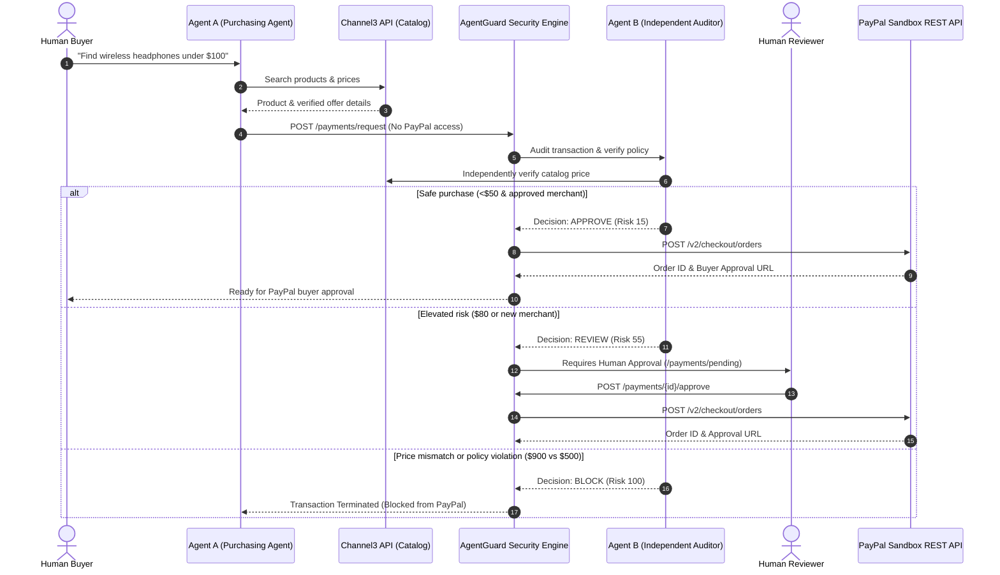

# AgentGuard 🛡️
### Independent Financial Firewall for Autonomous AI Agents

> **Core Philosophy:** *"AI agents can make purchases. AgentGuard makes sure they only spend what they're allowed to."*

Targeting the **PayPal AI Hackathon** — *Best Use of Agentic Commerce Track*.

---

## 1. Overview & Architecture

Autonomous AI agents can discover products, negotiate, and formulate purchase intent. However, granting autonomous agents direct access to financial credentials or unlimited payment authorization introduces massive risks of prompt injection, hallucinated transactions, price tampering, and runaway spending.

**AgentGuard** solves this by acting as an independent, deterministic financial firewall between AI agents and payment processors like PayPal.

### Key Architecture Principles:
1. **Agent Isolation (Zero Credentials):** Purchasing Agent (Agent A) NEVER receives PayPal credentials or direct payment authority.
2. **Independent Deterministic Auditor (Agent B):** An independent security engine evaluates spending limits, daily budgets, merchant whitelists, verified catalog prices, duplicate idempotencies, and velocity anomalies. Python policy logic is the **final authority**—an LLM can explain decisions but can never override hard security rules.
3. **Tri-State Authorization:**
   - **`APPROVE`** (Risk 0–24 & under auto threshold): PayPal Order created automatically.
   - **`REVIEW`** (Risk 25–59): Payment held in `REQUIRES_APPROVAL` until a human reviewer approves or rejects.
   - **`BLOCK`** (Risk 60–100 or hard policy violation): Hard stop; transaction never touches PayPal.



---

## 2. Backend–Frontend Integration Contract

The repo includes a FastAPI backend (`backend/`) and a web dashboard (`frontend/`). Any other client (React/Next.js, mobile, another agent) can connect to these documented endpoints:

| Frontend Feature | Method | Endpoint | Request Body | Response Description |
|---|---|---|---|---|
| **Dashboard Metrics** | `GET` | `/dashboard/stats` | None | Total transactions, daily spend, remaining budget, auto-approved/pending/blocked counts, avg risk score |
| **Activity Stream** | `GET` | `/dashboard/activity?limit=20` | None | Audit log timeline with timestamps, actions, risk reasons, and metadata |
| **List Agents** | `GET` | `/agents` | None | Registered AI agents, statuses (`active`/`paused`), and spending limits |
| **Register Agent** | `POST` | `/agents` | `{ name, daily_limit, max_transaction, auto_approval_limit }` | Created agent object with unique ID |
| **Pause Agent** | `POST` | `/agents/{id}/pause` | None | Pauses agent (blocks all subsequent payment requests) |
| **Activate Agent** | `POST` | `/agents/{id}/activate` | None | Re-activates a paused agent |
| **Natural Language Shopping** | `POST` | `/agents/purchase-instruction` | `{ agent_id, instruction }` | Agent A parses intent, searches catalog, and generates structured payment request |
| **Product Search** | `GET` | `/products/search?q={query}` | Query param `q`, optional `max_price` | Products returned from Channel3 with verified prices and merchants |
| **Get Security Rules** | `GET` | `/security/rules` | None | Current daily limit, max transaction limit, auto approval limit, allowed & restricted merchants |
| **Update Security Rules** | `PUT` | `/security/rules` | `{ daily_limit, max_transaction, auto_approval_limit, allowed_merchants, restricted_merchants }` | Updated security rules (Requires admin header `x-actor-role: admin`) |
| **Submit Payment Request** | `POST` | `/payments/request` | `{ agent_id, product_name, merchant, amount, currency, product_reference, idempotency_key }` | Financial evaluation outcome (`decision`: `APPROVE`, `REVIEW`, `BLOCK`, `risk_score`, `paypal_order_id`) |
| **All Payments** | `GET` | `/payments?status={status}` | Optional filters: `status`, `decision`, `agent_id` | Paginated transaction history |
| **Pending Approvals** | `GET` | `/payments/pending` | None | Transactions in `REQUIRES_APPROVAL` state |
| **Approve Payment** | `POST` | `/payments/{id}/approve` | `{ reviewer_notes?: string }` | Approves payment, creates PayPal order, and returns `paypal_approval_url` |
| **Reject Payment** | `POST` | `/payments/{id}/reject` | `{ reviewer_notes?: string }` | Rejects payment permanently (never touches PayPal) |
| **Capture Payment** | `POST` | `/payments/{id}/capture` | None | Captures authorized funds upon PayPal buyer completion |
| **Health Check** | `GET` | `/health` | None | Server health, version, environment timestamp |
| **Integrations Status** | `GET` | `/integrations/status` | None | Real-time status of PayPal Sandbox, Channel3, and AI Provider |

---

## 3. Technology Stack

- **Framework:** Python 3.12+ / FastAPI
- **Validation:** Pydantic v2
- **Database:** SQLAlchemy 2.0 (SQLite for local MVP, PostgreSQL compatible for production)
- **HTTP Client:** HTTPX (async REST integration)
- **AI Engine:** Google Gemini API (`google-genai`) / OpenAI API (`openai`) with instant deterministic fallback
- **Payments:** PayPal REST API (OAuth 2.0, Orders API v2, Webhook signature verification)
- **Product Discovery:** Channel3 API
- **Testing:** Pytest (18 automated tests passing) & Postman Collection v2.1
- **Deployment:** Render (`render.yaml` blueprint included)

---

## 4. Quickstart & Local Setup

### 1. Clone & Set Up Virtual Environment
```bash
git clone https://github.com/your-username/agentguard.git
cd agentguard

python -m venv .venv
# Windows:
.venv\Scripts\activate
# Linux/Mac:
source .venv/bin/activate
```

### 2. Install Dependencies
```bash
pip install -r backend/requirements.txt
```

### 3. Configure Environment Variables
Copy `.env.example` to `backend/.env`:
```bash
cp backend/.env.example backend/.env
```
Fill in your credentials (or test with built-in fallbacks):
```env
PORT=8000
HOST=0.0.0.0
ENVIRONMENT=development
CORS_ORIGINS=*

# PayPal Sandbox Credentials
PAYPAL_CLIENT_ID=your_paypal_sandbox_client_id
PAYPAL_CLIENT_SECRET=your_paypal_sandbox_client_secret
PAYPAL_BASE_URL=https://api-m.sandbox.paypal.com

# Channel3 Product Discovery
CHANNEL3_API_KEY=your_channel3_api_key
CHANNEL3_BASE_URL=https://api.channel3.ai

# Optional AI Providers (Deterministic fallback is always active if omitted)
GEMINI_API_KEY=your_gemini_api_key
OPENAI_API_KEY=your_openai_api_key
```

### 4. Run the Backend Server
```bash
uvicorn backend.main:app --reload --host 0.0.0.0 --port 8000
```
- Interactive Swagger UI: `http://localhost:8000/docs`
- ReDoc Documentation: `http://localhost:8000/redoc`
- Health check: `http://localhost:8000/health`

---

## Live Demo & PayPal Sandbox

- **Live URL:** _add your Render URL here after deploying_ (`/docs` for the interactive API, `/health` to check it is awake)
- **Real PayPal Sandbox orders:** set `PAYPAL_CLIENT_ID` and `PAYPAL_CLIENT_SECRET` (from developer.paypal.com > Apps & Credentials > Sandbox). Without them the app runs in offline mode and returns `MOCK-ORDER-...` IDs (`is_mock: true`). Check `GET /integrations/status` to confirm which mode is active.
- **Demo video:** _add link here_ (show Scenario 1, 2 and 3 below)

---

## 5. Required Demo Scenarios

AgentGuard includes pre-configured demo scenarios that can be executed via Swagger UI or the provided Postman collection:

### Scenario 1: Auto Approval
- **Product:** Wireless Keyboard (`prod_kb_001`)
- **Merchant:** `TrustedStore` (Whitelisted)
- **Amount:** `$20.00`
- **Auto Approval Limit:** `$50.00`
- **Result:** **`AUTO APPROVED`**
- **Action:** Generates an active PayPal Order ID and buyer approval link.

```bash
curl -X POST http://localhost:8000/payments/request \
  -H "Content-Type: application/json" \
  -d '{
    "agent_id": "shopping_agent",
    "product_name": "Wireless Keyboard",
    "merchant": "TrustedStore",
    "amount": "20.00",
    "currency": "USD",
    "product_reference": "prod_kb_001",
    "idempotency_key": "scenario_1_auto_001"
  }'
```

### Scenario 2: Human Approval Required
- **Product:** Wireless Headphones (`prod_hp_002`)
- **Merchant:** `NewStore` (Unapproved merchant: +30 risk)
- **Amount:** `$80.00` (Exceeds $50 auto-threshold: +25 risk)
- **Result:** **`HUMAN APPROVAL REQUIRED`** (`decision`: `REVIEW`, `risk_score`: 55)
- **Action:** Held in `REQUIRES_APPROVAL`. Once approved via `POST /payments/{id}/approve`, the PayPal Order is created.

```bash
curl -X POST http://localhost:8000/payments/request \
  -H "Content-Type: application/json" \
  -d '{
    "agent_id": "shopping_agent",
    "product_name": "Wireless Headphones",
    "merchant": "NewStore",
    "amount": "80.00",
    "currency": "USD",
    "product_reference": "prod_hp_002",
    "idempotency_key": "scenario_2_review_002"
  }'
```

### Scenario 3: Manipulated Payment Blocked
- **Product:** Laptop (`prod_lp_003`)
- **Verified Catalog Price:** `$500.00`
- **Submitted Amount:** `$900.00`
- **Result:** **`BLOCKED`**
- **Reason:** *"Product price does not match verified offer: submitted $900.00 vs verified $500.00"*
- **Action:** Terminated immediately. **Never reaches PayPal.**

```bash
curl -X POST http://localhost:8000/payments/request \
  -H "Content-Type: application/json" \
  -d '{
    "agent_id": "shopping_agent",
    "product_name": "Laptop",
    "merchant": "TechStore",
    "amount": "900.00",
    "currency": "USD",
    "product_reference": "prod_lp_003",
    "idempotency_key": "scenario_3_manipulated_003"
  }'
```

---

## 6. Security & Risk Engine Mechanics

### Deterministic Checks (Hard Policy Violations):
1. **Agent Active Status:** Inactive/paused agents are hard blocked.
2. **Maximum Transaction Limit:** Single purchase cannot exceed `$100.00` (or agent-specific override).
3. **Daily Budget Enforcement:** Concurrency-safe calculation of today's total spending cannot exceed `$200.00`.
4. **Merchant Policies:** Blacklisted merchants trigger immediate hard blocks.
5. **Price Verification:** Submitted amount must match the verified catalog offer within `$0.01`.
6. **Permitted Currencies:** Only approved currencies (default `USD`).
7. **Idempotency & Duplicate Protection:** Duplicate idempotency keys or identical requests submitted in rapid succession are blocked.

### Dynamic Risk Scoring Matrix:
| Risk Trigger | Risk Points Added |
|---|---|
| New / Unapproved Merchant | **+30** |
| Amount above Auto-Approval Threshold ($50) | **+25** |
| Price Mismatch | **+40** |
| Unusual Purchasing Velocity (>3 tx / 5 min) | **+20** |
| Duplicate Order Pattern | **+50** |

- **Score 0–24:** Auto-Approve
- **Score 25–59:** Human Review Required
- **Score 60–100:** Blocked

> **Hard Override Rule:** Any hard policy violation automatically forces the decision to **`BLOCK`** regardless of risk score.

---

## 7. Running Automated Tests

Run the full automated test suite covering security checks, human approvals, PayPal mocking, and AI agents:
```bash
python -m pytest tests/ -v
```
The suite covers the core security rules:
- `test_scenario_1_auto_approval`
- `test_scenario_2_human_approval`
- `test_scenario_3_manipulated_price_blocked`
- `test_max_transaction_limit_exceeded`
- `test_daily_budget_limit_exceeded`
- `test_restricted_merchant_blocked`
- `test_inactive_agent_blocked`
- `test_duplicate_idempotency_key_blocked`
- `test_agent_cannot_modify_security_policies`
- `test_payment_approval_workflow`
- `test_payment_rejection_workflow`
- `test_payment_capture_workflow`
- `test_paypal_webhook_processing`
- `test_buyer_agent_instruction_processing`
- `test_buyer_agent_isolation`
- `test_independent_auditor_authority`
- `test_purchase_instruction_endpoint`
- `test_dashboard_stats_and_activity`

---

## 8. Postman Collection

Import `postman/AgentGuard.postman_collection.json` into Postman.
- Configured with environment variables (`{{baseUrl}}`, `{{agentId}}`, `{{transactionId}}`).
- Includes automatic test scripts that save newly created transaction IDs for seamless approval/rejection testing.

---

## 9. Render Deployment Instructions

The repository is configured for one-click deployment on [Render](https://render.com) using the included `render.yaml`.

### Steps:
1. Push this repository to GitHub.
2. In Render Dashboard, click **New +** -> **Blueprint**.
3. Select your repository. Render will automatically detect `render.yaml`.
4. Set your environment variables in the Render dashboard:
   - `PAYPAL_CLIENT_ID`
   - `PAYPAL_CLIENT_SECRET`
   - `CHANNEL3_API_KEY`
   - `GEMINI_API_KEY` (or `OPENAI_API_KEY`)
5. Click **Apply**.
6. Render will run:
   - Build Command: `pip install -r backend/requirements.txt`
   - Start Command: `uvicorn backend.main:app --host 0.0.0.0 --port $PORT`

### Production Database Recommendation:
For persistent production storage, provision a free **Render PostgreSQL** database and paste the connection string into the `DATABASE_URL` environment variable. The backend automatically formats the connection string for SQLAlchemy.

---

## Demo Agent

`demo_agent.py` simulates an AI shopping agent (no PayPal credentials) trying six purchases:
safe (APPROVE), unknown merchant (REVIEW), price tampering (BLOCK), restricted merchant (BLOCK),
and a replayed request (BLOCK). It then lets you approve the held payment.

```bash
uvicorn backend.main:app --port 8000     # terminal 1
python demo_agent.py                      # terminal 2 (add --auto-approve to skip the prompt)
```
